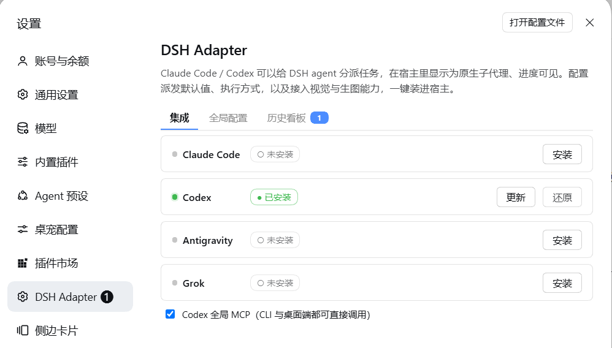
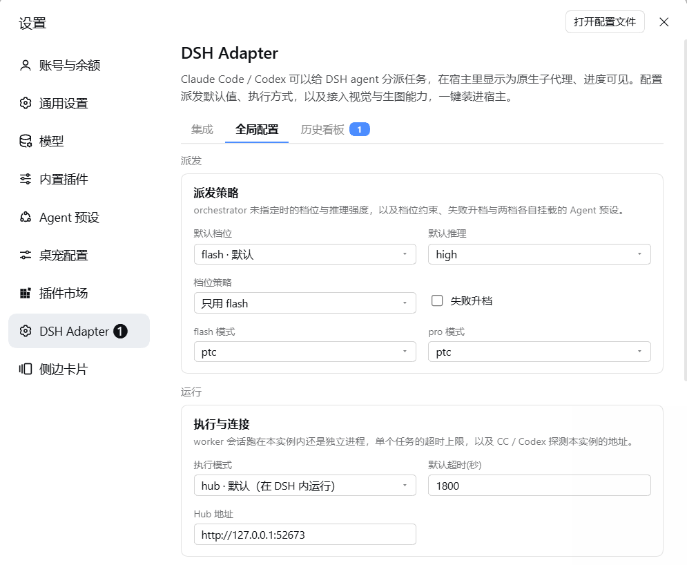
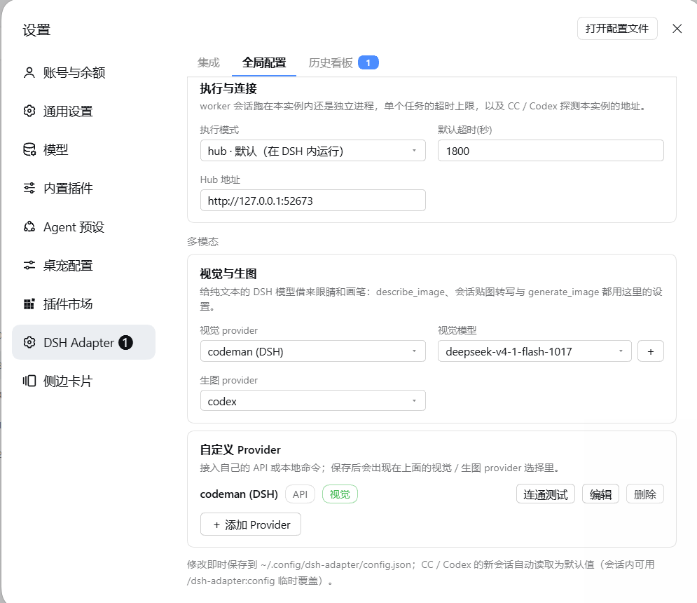
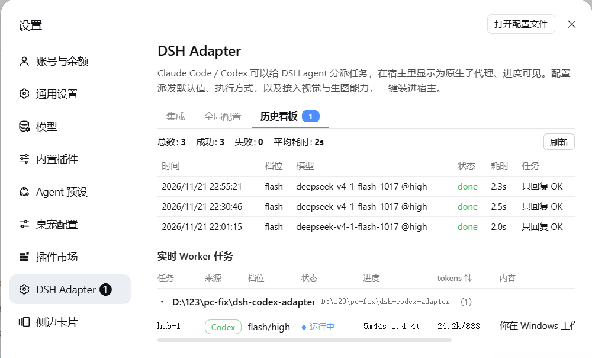

<p align="center">
  
</p>

<h1 align="center">DSH Adapter</h1>

<p align="center">
  <sub>Independent fork of <a href="https://github.com/ZSeven-W/dsh-crew">dsh-crew</a> (MIT) &mdash; see <a href="./NOTICE">NOTICE</a>.</sub>
</p>

<p align="center">
  <strong>Claude Code / Codex can dispatch tasks to DSH agents and see them as native subagents in the host with live progress. Configure dispatch defaults, execution mode, and vision / image-generation access, then install into the host in one click.</strong><br />
  <sub>Hub-Only by Default &bull; Tier Routing &bull; Upstream Capability Catalog &bull; Jobs &amp; History Board &bull; Vision &amp; Image Gen &bull; One-Click Install</sub>
</p>

<p align="center">
  <sub>npm: <code>@zoraxylia/dsh-codex-adapter</code> &middot; Latest: <code>0.1.41</code> &middot; Requires DSH to be running (hub mode)</sub>
</p>

<p align="center">
  <a href="./README.md"><b>English</b></a> &middot; <a href="./README.zh.md">简体中文</a> &middot; <a href="./README.zh-TW.md">繁體中文</a> &middot; <a href="./README.ja.md">日本語</a> &middot; <a href="./README.ko.md">한국어</a> &middot; <a href="./README.fr.md">Français</a> &middot; <a href="./README.es.md">Español</a> &middot; <a href="./README.de.md">Deutsch</a> &middot; <a href="./README.pt.md">Português</a> &middot; <a href="./README.ru.md">Русский</a> &middot; <a href="./README.hi.md">हिन्दी</a> &middot; <a href="./README.tr.md">Türkçe</a> &middot; <a href="./README.th.md">ไทย</a> &middot; <a href="./README.vi.md">Tiếng Việt</a> &middot; <a href="./README.id.md">Bahasa Indonesia</a>
</p>

<p align="center">
  <a href="./LICENSE"></a>
  
</p>

<br />

<p align="center">
  
</p>
<p align="center"><sub>Settings &rarr; DSH Adapter &rarr; Integrations: one row per host, with a status dot and an inline result for every action.</sub></p>

## Why DSH Adapter

[DeepSeek Harness](https://github.com/deepseek-ai/deepseek-harness) (DSH) is an open-source agent harness with real tools, sandboxes, presets and session history. DSH Adapter makes those agents callable from the host you already work in.

The orchestrator keeps its own model and its own plan. The work runs on a real DSH agent inside a running DSH instance, which is why progress, tokens and the final result can be shown as a native subagent — and why the worker's session is still inspectable in the DSH Web UI afterwards.

- **Native, not a black box.** Workers show up in Claude Code / Codex as subagents with live step, current tool and token counts; a statusline HUD is available for Claude Code.
- **Tiers with real routing.** `flash` for mechanical work, `pro` for reasoning. Each tier names a provider/model DSH already has; when it is left open the plugin picks a route that actually streams, using the provider's own capability catalog.
- **No hidden fallback.** Dispatch is hub-only by default. If DSH is not reachable you get a clear error instead of a silent switch to a runtime that the packaged plugin cannot provide.
- **Multimodal without leaving the harness.** Text-only models get eyes and a brush through the CLIs you already have, through DSH's own providers, or through any OpenAI-compatible endpoint you add.
- **A board, not a log file.** Live jobs and a durable history are one tab away, with counts, durations and failure reasons.

## Quick start

1. **Install the plugin into DSH**

   ```bash
   dsh plugin --profile desktop add @zoraxylia/dsh-codex-adapter
   ```

   (The marketplace install is the same package; either way the plugin lands in the DSH profile.)

2. **Start DSH, then open Settings &rarr; DSH Adapter**

   The host plugin mounts a local hub. Workers run as DSH sessions inside this instance, using the models DSH is already configured with.

3. **Install the host integration you use**

   | Host | What the install writes |
   |---|---|
   | Claude Code | A directory marketplace + enabled plugin in `~/.claude/settings.json`, MCP permissions, optional statusline HUD |
   | Codex | `ds-flash` / `ds-pro` agent roles in `~/.codex/agents`, prompts, and a global `[mcp_servers.dsh-adapter]` entry (toggleable) |
   | Antigravity / Grok | MCP server registration for that CLI |

   Restart the host client once. Codex desktop and the Codex CLI both read the same `~/.codex`, so one install covers both.

## Screenshots

<table>
<tr>
<td width="50%">


<sub><b>Dispatch policy.</b> Default tier and effort, tier clamp, failure escalation, and the Agent preset mounted for each tier.</sub>

</td>
<td width="50%">


<sub><b>Runtime and multimodal.</b> Execution mode (hub by default), timeout, hub address, vision / image provider, custom providers.</sub>

</td>
</tr>
<tr>
<td colspan="2">


<sub><b>History board.</b> Durable history with success/failure counts and average duration, plus the live jobs board with per-workspace groups.</sub>

</td>
</tr>
</table>

## Using it

### Codex (desktop or CLI)

Codex has no subagent spawn UI in the desktop client, so the installer registers the MCP server globally: any session can call the worker tools directly.

```
Use dsh_run_worker to fix the failing test in D:/repo, tier pro,
cwd D:/repo, timeout 900. Report the diff and the test output.
```

While a job runs, ask Codex to follow it instead of guessing:

```
Call dsh_worker_watch on hub-1-… with after=<cursor>, wait_seconds=30,
and tell me each tool call (command included) as it happens.
```

The tool returns the next slice of live events — tool name, its arguments,
tool result summary, assistant text and step boundaries — plus a cursor for
the next call. `dsh_worker_status` also carries the last 12 events per job.

The CLI additionally gets two agent roles:

```
spawn ds-flash to rename the getter in src/config.ts and run the tests
spawn ds-pro to review the migration in db/migrations and list the risks
```

### Claude Code

The plugin's marketplace entry exposes the same tools. Ask for a worker, or use the provided prompts:

```
/dsh-status      # live jobs, locks and token usage
/dsh-config      # session-level tier / mode / route settings
```

### Tool surface

| Tool | Purpose |
|---|---|
| `dsh_run_worker` | Run one task and block until it finishes |
| `dsh_spawn_worker` | Start a task in the background; returns a job id |
| `dsh_worker_status` | Live jobs, current tool, tokens, workspace locks |
| `dsh_worker_result` | Fetch a job's final result, optionally waiting |
| `dsh_worker_watch` | Follow a running job: new tool calls, arguments, results and assistant text since a cursor |
| `dsh_worker_cancel` | Cancel a job and release its lock |
| `dsh_worker_config` | Read or change session tier / mode / route / policy |
| `dsh_worker_probe` | Test one configured provider/model with a tiny request |
| `describe_image` / `generate_image` | Vision and image generation through the configured bridge |

## Tiers, routing and capabilities

A tier is a name for "how much capability", not a hardcoded model. Each tier resolves in this order:

1. an explicit `provider` / `model` passed by the caller;
2. a binding stored in the settings page (`flash_provider`, `flash_model`, …);
3. the built-in default.

When a tier is left unbound, the plugin probes the providers DSH has configured and binds the first route that actually streams, then persists it. Reasoning effort is chosen by intersecting the host's local model metadata with the **provider's own catalog** (`/v1/models`), so a level the upstream dropped is never sent. If a model declares no reasoning metadata at all, the effort is omitted entirely instead of guessed.

```bash
npm run caps:sync                       # show local vs upstream differences
npm run caps:sync -- --provider <id> --write   # write them into the DSH profile
```

## Settings reference

| Key | Default | Meaning |
|---|---|---|
| `mode` | `hub` | `hub` requires DSH; `auto` falls back to standalone; `standalone` never uses the hub |
| `default_tier` | `flash` | Tier used when a dispatch does not name one |
| `default_effort` | `high` | `off` / `high` / `max` |
| `default_timeout_seconds` | `1800` | Per-task cap (enforced by the hub) |
| `stall_timeout_seconds` | `600` | Fail a hub job that emits no session event for this long |
| `tier_policy` | `auto` | `flash-only` / `pro-only` clamp every dispatch |
| `escalate_on_failure` | `false` | Retry a failed flash run once on pro |
| `preset_flash` / `preset_pro` | `default` | Agent preset mounted for hub workers |
| `hub_url` | synced | Local hub address; the host rewrites it on every launch |
| `vision_provider` / `vision_model` | `codex` / `default` | Vision bridge backend |
| `imagegen_provider` | `codex` | Image generation backend |
| `custom_providers` | `[]` | OpenAI-compatible endpoints or local commands |
| `codex_global_mcp` | `true` | Register the Codex MCP server globally (CLI + desktop) |
| `caps_ttl_seconds` | `21600` | Upstream capability cache lifetime |

## Vision and image generation

DSH's chat models are text-only. The bridge gives them eyes and a brush without leaving the harness:

- **DSH providers first.** Every provider configured in DSH that declares image input is offered as a ready-made backend — no base URL, no key duplication. Turning the model into a native multimodal one also silences the bridge: transcription is skipped when the selected model accepts images itself.
- **Subscription CLIs.** Claude, Codex, Grok and Antigravity can answer `describe_image` and draw with `generate_image`.
- **Custom providers.** Any OpenAI-compatible endpoint or local command; keys resolve from the environment or the local credential store and are never written into the plugin config.

Pasted images stay visible in the conversation and reach a text-only model as a transcription block.

## Jobs, history and guardrails

- **Live board** — grouped by workspace, with status, step, current tool, tokens and a per-job task cell. Click a row to expand its event stream (tool calls with arguments, results, assistant text) and keep it updating every 2s while the job runs.
- **Durable history** — terminal jobs are appended once to `~/.config/dsh-adapter/history.jsonl` (2000 records / 8 MB cap) and served by `GET /history` with tier / status / source filters, paging and aggregates. Existing status shards are imported on first run.
- **Guardrails** — worker→worker nesting is capped by an origin chain (default depth 3), and a second writer on a workspace another job holds is refused with the holder's info instead of being queued.
- **Route trust** — every hub HTTP route first asks DSH's `ctx.connection.requestRejection()` for a verdict (Host/Origin fence plus browser authentication), so a page open in the user's browser cannot drive the loopback API. The bundled MCP client is loopback-only and sends no browser markers, so its local channel keeps working.

## Architecture

```
Claude Code / Codex                 DSH (localhost)
  │  MCP tool call                    ┌──────────────────────────────┐
  ├──────────────► MCP server ───────►│ hub plugin (host)            │
  │                                   │  · resolves tier → route     │
  │                                   │  · probes / binds / persists │
  │                                   │  · creates a DSH session     │
  │  ◄──────────── job events ────────│  · publishes status          │
  │                                   └──────────────┬───────────────┘
  │                                                  │
  │                                    DSH agent session (Web UI visible)
```

The MCP server is a thin client: it holds no model credentials and never calls a provider itself in hub mode. The hub lives in the DSH host plugin, which is also what makes sessions and progress observable.

## Requirements and troubleshooting

- **DSH must be running.** Dispatch is hub-only by default; the packaged plugin ships neither the DSH SDK nor the worker runtime, so it cannot run a worker on its own.
- **"hub not reachable"** — start DSH, or check that `hub_url` matches the current port. The host rewrites it on launch, and the MCP client re-reads it on every call since 0.1.19.
- **Codex desktop does not see the tools** — restart the client after installing; also check that the global MCP toggle is on (Settings &rarr; Integrations).
- **A worker seems stuck** — the board shows `stalled` after 120s without an event, and the hub fails the job after `stall_timeout_seconds` (default 600s), releasing the workspace lock. PTC's `run_code` is the usual suspect: its workflow disables the runtime deadline.
- **A dispatch fails with an unsupported effort** — run `npm run caps:sync` against the profile; the local dictionary may be older than the provider's catalog.
- **Windows: every command fails with `SetNamedSecurityInfoW failed (Win32 5)`** — the system temp root cannot inherit your full control (common when TEMP was moved). The plugin detects this at startup and points TMP/TEMP at `%LOCALAPPDATA%\dsh-adapter\temp`; `GET /_dsh/dsh-adapter/doctor` reports the chosen root. No manual ACL change is needed.
- **Standalone messages** — `standalone` is a source-checkout mode. In an installed plugin the message tells you to run workers inside DSH instead of suggesting a package install.

## Development

```bash
pnpm install
pnpm test            # unit + wiring tests (node:test)
pnpm run smoke:pack  # build, pack, install into a temp dir, MCP handshake
npm run caps:sync    # compare local model capabilities with upstream
```

The repository is its own Claude Code marketplace (`.claude-plugin/`), and the Codex roles / prompts live in `codex/`.

## License

MIT. Forked from [ZSeven-W/dsh-crew](https://github.com/ZSeven-W/dsh-crew); upstream copyright and attribution are preserved in [NOTICE](./NOTICE) and the original [LICENSE](./LICENSE).
