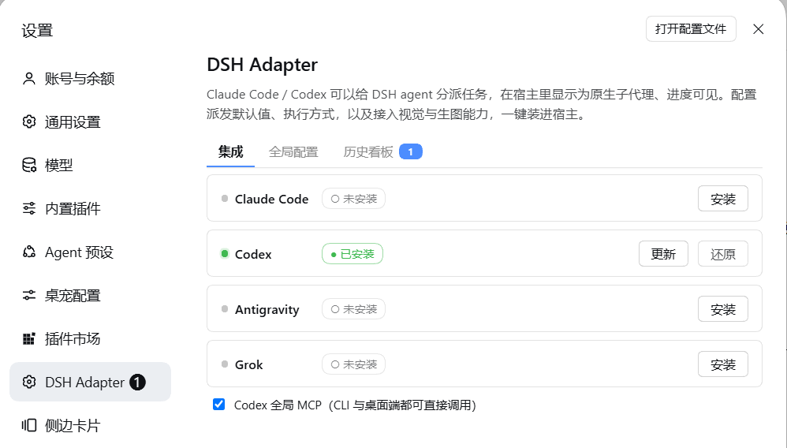
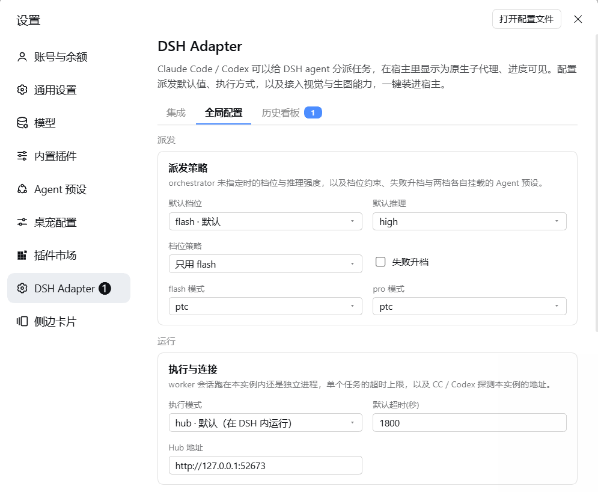
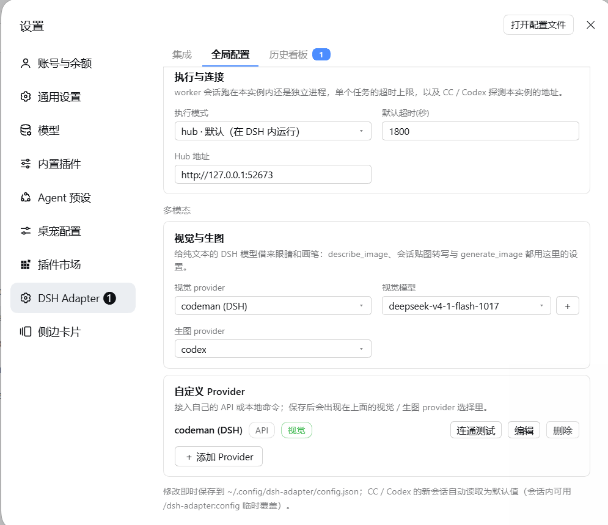
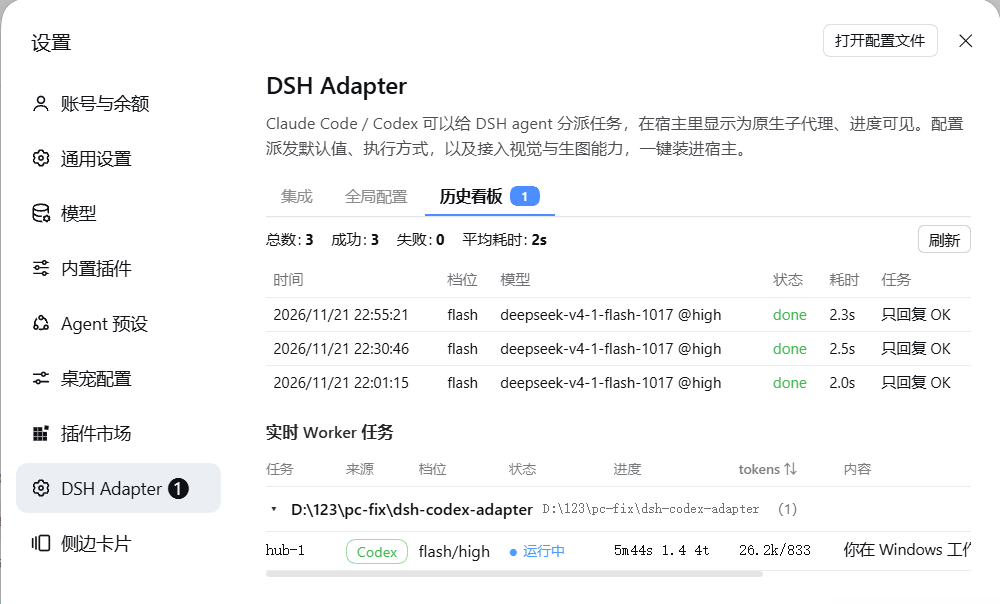

<p align="center">
  
</p>

<h1 align="center">DSH Adapter</h1>

<p align="center">
  <sub><a href="https://github.com/ZSeven-W/dsh-crew">dsh-crew</a> 的独立分支（MIT）&mdash; 见 <a href="./NOTICE">NOTICE</a>。</sub>
</p>

<p align="center">
  <strong>Claude Code / Codex 可以给 DSH agent 分派任务，在宿主里显示为原生子代理、进度可见。配置派发默认值、执行方式，以及接入视觉与生图能力，一键装进宿主。</strong><br />
  <sub>默认 hub-only &bull; 档位路由 &bull; 上游能力字典 &bull; 任务与历史看板 &bull; 视觉与生图 &bull; 一键安装</sub>
</p>

<p align="center">
  <sub>npm: <code>@zoraxylia/dsh-codex-adapter</code> &middot; 当前版本 <code>0.1.22</code> &middot; 需要 DSH 正在运行（hub 模式）</sub>
</p>

<p align="center">
  <a href="./README.md">English</a> &middot; <a href="./README.zh.md"><b>简体中文</b></a> &middot; <a href="./README.zh-TW.md">繁體中文</a> &middot; <a href="./README.ja.md">日本語</a> &middot; <a href="./README.ko.md">한국어</a> &middot; <a href="./README.fr.md">Français</a> &middot; <a href="./README.es.md">Español</a> &middot; <a href="./README.de.md">Deutsch</a> &middot; <a href="./README.pt.md">Português</a> &middot; <a href="./README.ru.md">Русский</a> &middot; <a href="./README.hi.md">हिन्दी</a> &middot; <a href="./README.tr.md">Türkçe</a> &middot; <a href="./README.th.md">ไทย</a> &middot; <a href="./README.vi.md">Tiếng Việt</a> &middot; <a href="./README.id.md">Bahasa Indonesia</a>
</p>

<p align="center">
  <a href="./LICENSE"></a>
  
</p>

<br />

<p align="center">
  
</p>
<p align="center"><sub>设置 → DSH Adapter → 集成：每个宿主一行，带状态色点，每次操作的结果就地显示。</sub></p>

## 为什么用它

[DeepSeek Harness](https://github.com/deepseek-ai/deepseek-harness)（DSH）是一个开源 agent 框架，自带工具、沙箱、预设和会话历史。DSH Adapter 把这些 agent 变成你当前宿主可以直接调用的能力。

调度方保留自己的模型和计划，具体工作由运行中的 DSH 实例里的真实 agent 完成——这也是为什么进度、token 和结果能像原生子代理一样展示，并且任务结束后仍能在 DSH Web UI 里查到完整会话。

- **原生可见，不是黑盒。** worker 在 Claude Code / Codex 里以子代理形式出现，能看到当前步骤、正在用的工具和 token；Claude Code 还支持状态栏 HUD。
- **档位有真实路由。** `flash` 做机械活、`pro` 做推理活；每个档位指向 DSH 已配置的 provider/model。未绑定时插件会探测真正能出流的路由并记住它，依据的是 provider 自己的模型能力字典。
- **没有暗回退。** 派发默认 hub-only：DSH 不可达就直接报错，而不是悄悄切到打包插件根本无法提供的独立运行时。
- **多模态不离开 harness。** 纯文本模型通过你已有的 CLI、DSH 自己的 provider，或任意 OpenAI 兼容端点获得“眼睛”和“画笔”。
- **有看板，不只是日志。** 实时任务与持久历史在同一个 tab 里，带数量、耗时和失败原因。

## 快速开始

1. **把插件装进 DSH**

   ```bash
   dsh plugin --profile desktop add @zoraxylia/dsh-codex-adapter
   ```

2. **启动 DSH，打开 设置 → DSH Adapter**

   宿主插件会挂载本地 hub，worker 作为本实例内的 DSH 会话运行，复用 DSH 已配置的模型凭据。

3. **安装你要用的宿主集成**

   | 宿主 | 安装会写入什么 |
   |---|---|
   | Claude Code | `~/.claude/settings.json` 里的本地 marketplace + 启用插件 + MCP 权限，可选状态栏 HUD |
   | Codex | `~/.codex/agents` 下的 `ds-flash` / `ds-pro` 角色、prompts，以及全局 `[mcp_servers.dsh-adapter]`（可开关） |
   | Antigravity / Grok | 对应 CLI 的 MCP 注册 |

   重启一次宿主客户端。Codex 桌面端和 CLI 共用同一份 `~/.codex`，装一次两边都能用。

## 界面

<table>
<tr>
<td width="50%">


<sub><b>派发策略。</b>默认档位与推理强度、档位约束、失败升档，以及两档各自挂载的 Agent 预设。</sub>

</td>
<td width="50%">


<sub><b>执行与多模态。</b>执行模式（默认 hub）、超时、hub 地址、视觉/生图 provider、自定义 provider。</sub>

</td>
</tr>
<tr>
<td colspan="2">


<sub><b>历史看板。</b>持久历史（成功/失败数量、平均耗时），以及按工作区分组的实时任务看板。</sub>

</td>
</tr>
</table>

## 怎么用

### Codex（桌面端或 CLI）

桌面端没有“创建子代理”的 UI，所以安装器会把 MCP server 注册到全局，任何会话都能直接调：

```
用 dsh_run_worker 修复 D:/repo 里失败的测试，档位 pro，cwd D:/repo，超时 900，最后贴出 diff 和测试输出。
```

任务运行期间，可以让 Codex 持续跟进，而不是靠猜：

```
用 dsh_worker_watch 跟进 hub-1-…，after=<cursor>，wait_seconds=30，
每发生一次工具调用（包括执行的命令）就告诉我。
```

该工具返回下一段实时事件——工具名、参数、结果摘要、助手文本、步骤边界——并给出下一次调用的 cursor。`dsh_worker_status` 也会带上每个任务最近 12 条事件。

CLI 额外得到两个 agent 角色：

```
spawn ds-flash 把 src/config.ts 里的 getter 改名并跑测试
spawn ds-pro 审查 db/migrations 下的迁移并列出风险
```

### Claude Code

插件的 marketplace 条目会暴露同一套工具。直接让模型派活，或使用内置 prompt：

```
/dsh-status      # 实时任务、锁与 token
/dsh-config      # 会话级档位 / 模式 / 路由设置
```

### 工具列表

| 工具 | 作用 |
|---|---|
| `dsh_run_worker` | 运行一个任务并阻塞到完成 |
| `dsh_spawn_worker` | 后台启动任务，返回 job id |
| `dsh_worker_status` | 实时任务、当前工具、token、工作区锁 |
| `dsh_worker_result` | 取任务最终结果，可等待 |
| `dsh_worker_watch` | 跟进运行中的任务：按 cursor 返回新的工具调用、参数、结果与助手文本 |
| `dsh_worker_cancel` | 取消任务并释放锁 |
| `dsh_worker_config` | 读取或修改会话级档位/模式/路由/策略 |
| `dsh_worker_probe` | 用极小的请求测试某个 provider/model |
| `describe_image` / `generate_image` | 通过配置的桥接做视觉与生图 |

## 档位、路由与能力

档位表达的是“需要多少能力”，不是写死的模型。解析顺序：

1. 调用方显式传入的 `provider` / `model`；
2. 设置页保存的绑定（`flash_provider`、`flash_model` 等）；
3. 内置默认值。

未绑定时，插件会探测 DSH 已配置的 provider，绑定第一个真正能出流的路由并持久化。推理强度取“宿主本地模型元数据 ∩ **provider 自己的 `/v1/models` 能力字段**”，上游已去掉的等级不会发送；模型完全不声明推理能力时，直接不发送 effort，而不是猜一个。

```bash
npm run caps:sync                       # 查看本地与上游的差异
npm run caps:sync -- --provider <id> --write   # 写入 DSH profile
```

## 配置项

| 键 | 默认 | 含义 |
|---|---|---|
| `mode` | `hub` | `hub` 要求 DSH；`auto` 可回落独立进程；`standalone` 永不使用 hub |
| `default_tier` | `flash` | 未指定档位时使用 |
| `default_effort` | `high` | `off` / `high` / `max` |
| `default_timeout_seconds` | `1800` | 单任务上限（由 hub 强制执行） |
| `stall_timeout_seconds` | `600` | hub 任务超过该时长没有任何会话事件即判失败 |
| `tier_policy` | `auto` | `flash-only` / `pro-only` 强制约束所有派发 |
| `escalate_on_failure` | `false` | flash 失败后自动用 pro 重试一次 |
| `preset_flash` / `preset_pro` | `default` | hub worker 挂载的 Agent 预设 |
| `hub_url` | 自动同步 | 本地 hub 地址，宿主每次启动会重写 |
| `vision_provider` / `vision_model` | `codex` / `default` | 视觉桥后端 |
| `imagegen_provider` | `codex` | 生图后端 |
| `custom_providers` | `[]` | OpenAI 兼容端点或本地命令 |
| `codex_global_mcp` | `true` | 是否注册 Codex 全局 MCP（CLI + 桌面端） |
| `caps_ttl_seconds` | `21600` | 上游能力缓存时长 |

## 视觉与生图

DSH 的聊天模型是纯文本的，桥接让它们在不离开 harness 的前提下获得视觉与生图能力：

- **优先用 DSH 自己的 provider。** DSH 里声明了图片输入的 provider 会自动成为可用后端，不用填 base URL，也不用重复存 key。把模型换成原生多模态后，桥接会自动沉默：检测到模型本身支持图片输入时跳过转写，避免重复内容。
- **订阅制 CLI。** Claude、Codex、Grok、Antigravity 都能回答 `describe_image`，也能用 `generate_image` 出图。
- **自定义 provider。** 任意 OpenAI 兼容端点或本地命令；key 从环境变量或本地凭据库读取，不写进插件配置。

粘贴的图片仍显示在会话里，纯文本模型收到的是转写后的文本块。

## 任务、历史与护栏

- **实时看板**：按工作区分组，显示状态、步骤、当前工具、token 和任务摘要。点击任意行展开事件流（工具名与参数、结果、助手文本），运行中每 2 秒自动刷新。
- **持久历史**：终态任务只写一次到 `~/.config/dsh-adapter/history.jsonl`（2000 条 / 8 MB 上限），由 `GET /history` 提供档位/状态/来源过滤、分页与聚合；首次启动会从现有 status shard 回填。
- **护栏**：worker→worker 嵌套按 origin chain 限制（默认深度 3）；同一工作区已有写入任务时，第二个派发会被拒绝并给出持有者信息，而不是静默排队。

## 架构

```
Claude Code / Codex                 DSH（本机）
  │  MCP tool call                    ┌──────────────────────────────┐
  ├──────────────► MCP server ───────►│ hub 插件（宿主）              │
  │                                   │  · 解析档位 → 路由            │
  │                                   │  · 探测 / 绑定 / 持久化       │
  │                                   │  · 创建 DSH 会话              │
  │  ◄──────────── job events ────────│  · 发布状态                   │
  │                                   └──────────────┬───────────────┘
  │                                                  │
  │                                    DSH agent 会话（Web UI 可见）
```

MCP server 只是一个瘦客户端：在 hub 模式下它不持有模型凭据，也不直接调用 provider。hub 运行在 DSH 宿主插件里，这也是会话和进度可见的原因。

## 要求与排查

- **DSH 必须在运行。** 派发默认 hub-only；打包插件既不带 DSH SDK 也不带 worker runtime，无法自行运行 worker。
- **提示 “hub not reachable”**：启动 DSH，或确认 `hub_url` 与当前端口一致。宿主启动时会重写它，MCP 客户端从 0.1.19 起每次调用都会重新读取。
- **Codex 桌面端看不到工具**：装完后重启客户端；同时确认全局 MCP 开关是开的（设置 → 集成）。
- **worker 疑似卡住**：看板在 120 秒无事件后显示“疑似卡住”，hub 在 `stall_timeout_seconds`（默认 600 秒）后判失败并释放工作区锁。PTC 的 `run_code` 是常见原因：它的 workflow 关闭了运行时超时。
- **派发报推理强度不支持**：对 profile 跑一次 `npm run caps:sync`，本地字典可能落后于上游。
- **Windows 下所有命令都报 `SetNamedSecurityInfoW failed (Win32 5)`**：系统临时目录不能让当前用户继承完全控制（TEMP 被改到别处时常见）。插件启动时会检测并把自己的 `TMP`/`TEMP` 指向 `%LOCALAPPDATA%\dsh-adapter\temp`，`GET /_dsh/dsh-adapter/doctor` 会显示实际使用的目录，无需手动改权限。
- **standalone 相关提示**：`standalone` 只适用于源码 checkout；安装版会明确提示“在 DSH 内运行”，而不是让你去装包。

## 开发

```bash
pnpm install
pnpm test            # 单元与接线测试（node:test）
pnpm run smoke:pack  # 构建、打包、临时安装、MCP 握手
npm run caps:sync    # 对比本地与上游模型能力
```

仓库本身就是一个 Claude Code marketplace（`.claude-plugin/`），Codex 的角色和 prompts 在 `codex/` 下。

## 许可

MIT。分支自 [ZSeven-W/dsh-crew](https://github.com/ZSeven-W/dsh-crew)，上游版权与署名保留在 [NOTICE](./NOTICE) 与原始 [LICENSE](./LICENSE) 中。
